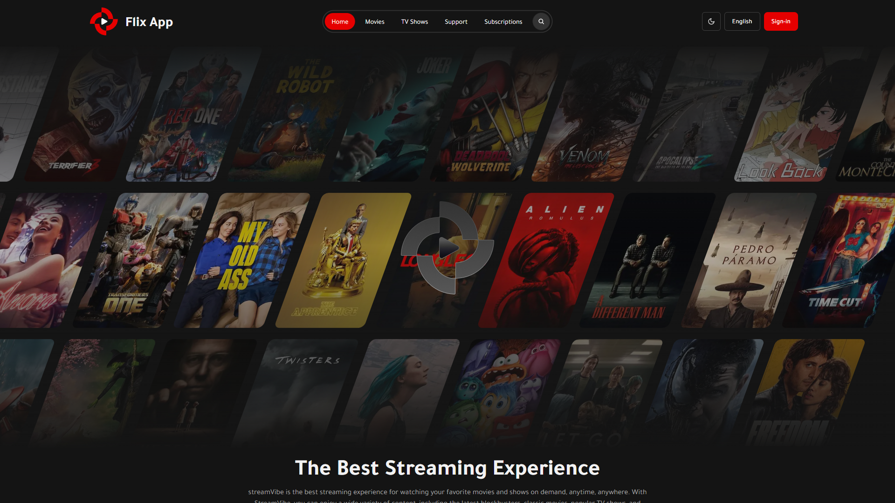
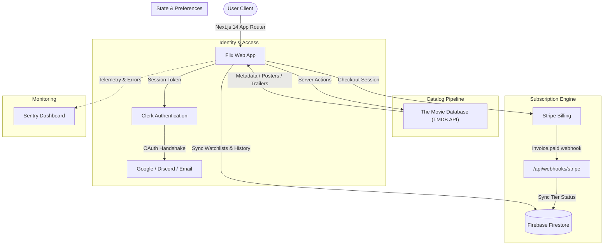

<div align="center">


# Flix

**Production-grade streaming and media discovery platform engineered with Next.js 14, Clerk authentication, Stripe billing, and Firebase Firestore.**

[](https://nextjs.org/)
[](https://www.typescriptlang.org/)
[](https://clerk.com/)
[](https://stripe.com/)
[](https://firebase.google.com/)
[](https://sentry.io/)

> A bilingual (Arabic/English) streaming experience with real-time watchlists, subscription tiers, TMDB catalog synchronization, and edge performance monitoring.

[**Explore Live Demo (flix.kareemadel.com)**](https://flix.kareemadel.com)

</div>

---



---

## Features

- **Content Discovery Engine:** Direct integration with TMDB API delivering paginated trending, top-rated, and categorized movie/series metadata.
- **Enterprise Authentication:** Multi-provider OAuth (Google, Discord, Facebook) and session verification powered by Clerk with Arabic & English localizations.
- **Subscription Management:** Automated Stripe checkout pipelines, customer billing portal, and crash-resilient webhook reconciliation for active tiers.
- **Real-Time Watchlists:** Low-latency user watchlists, viewing history, and favorites backed by Firebase Firestore.
- **Bilingual & Responsive:** Full RTL (Right-to-Left) Arabic and LTR English layouts with GSAP micro-animations and Tailwind CSS design tokens.
- **Production Observability:** Client, server, and edge error monitoring and distributed performance tracing instrumented via Sentry.

---

## Architecture & Integration Flow



---

## Prerequisites

- **Node.js** v18.17.0 or higher
- **pnpm** (recommended) or npm
- **TMDB API Key** (from [themoviedb.org](https://www.themoviedb.org/documentation/api))
- **Clerk Application** (from [clerk.com](https://clerk.com))
- **Firebase Project** with Firestore enabled (from [firebase.google.com](https://firebase.google.com))
- **Stripe Account** for subscription webhooks (from [stripe.com](https://stripe.com))

---

## Quick Start

### 1. Clone & Install

```bash
git clone https://github.com/KareemAdelAwwad/flix.git
cd flix
pnpm install
```

### 2. Configure Environment

Copy `.env.example` to `.env.local` and populate your API credentials:

```bash
cp .env.example .env.local
```

### 3. Start Development Server

```bash
pnpm run dev
```

Open [http://localhost:3000](http://localhost:3000) in your browser.

---

## Available Scripts

| Script | Purpose |
| :--- | :--- |
| `pnpm run dev` | Runs local development server on port 3000 |
| `pnpm run build` | Compiles production Next.js build |
| `pnpm run start` | Boots production server instance |
| `pnpm run lint` | Runs ESLint analysis across TypeScript & JSX files |

---

## Contributors

<table>
  <tr>
    <td align="center">
      <a href="https://github.com/KareemAdelAwwad">
        <br />
        <sub><b>Kareem Adel</b></sub>
      </a>
    </td>
    <td align="center">
      <a href="https://github.com/ibrahimwael951">
        <br />
        <sub><b>Ibrahim Wael</b></sub>
      </a>
    </td>
    <td align="center">
      <a href="https://github.com/HassanMo1390">
        <br />
        <sub><b>Hasan</b></sub>
      </a>
    </td>
  </tr>
</table>
